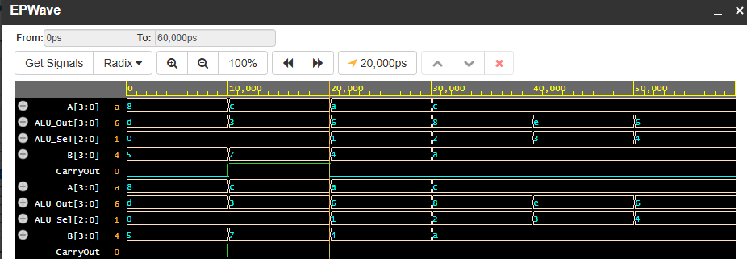

# 4-Bit Arithmetic Logic Unit (ALU) in Verilog HDL

A Register-Transfer Level (RTL) implementation of a 4-bit Arithmetic Logic Unit (ALU) designed and verified using Verilog HDL. The module performs arithmetic operations (addition with carry detection, subtraction) and bitwise logic operations (AND, OR, XOR, NOT, barrel shifts) within a single combinational evaluation cycle.

---

## Simulation Waveform (EPWave)



### Waveform Analysis
- **0–10 ns (`Sel = 000`):** $A = 8, B = 5 \rightarrow \text{Out} = \text{0xD}\,(13),\,\text{Carry} = 0$ (Addition).
- **10–20 ns (`Sel = 000`):** $A = 12, B = 7 \rightarrow \text{Out} = 3,\,\text{Carry} = 1$ (Addition Overflow: $12 + 7 = 19$).
- **20–30 ns (`Sel = 001`):** $A = 10, B = 4 \rightarrow \text{Out} = 6,\,\text{Carry} = 0$ (Subtraction).
- **30–40 ns (`Sel = 010`):** $A = 12\,(1100_2), B = 10\,(1010_2) \rightarrow \text{Out} = 8\,(1000_2)$ (Bitwise AND).
- **40–50 ns (`Sel = 011`):** $A = 12\,(1100_2), B = 10\,(1010_2) \rightarrow \text{Out} = 14\,(1110_2)$ (Bitwise OR).
- **50–60 ns (`Sel = 100`):** $A = 12\,(1100_2), B = 10\,(1010_2) \rightarrow \text{Out} = 6\,(0110_2)$ (Bitwise XOR).

---

## Operation Truth Table

The ALU evaluates inputs $A[3:0]$ and $B[3:0]$ based on a 3-bit opcode (`ALU_Sel[2:0]`):

| Opcode (`ALU_Sel`) | Operation | Expression | Function Type |
| :---: | :--- | :--- | :--- |
| `000` | **ADD** | $A + B$ | Arithmetic (with `CarryOut` flag) |
| `001` | **SUB** | $A - B$ | Arithmetic |
| `010` | **AND** | $A \ \& \ B$ | Bitwise Logic |
| `011` | **OR**  | $A \ \Vert{} \ B$ | Bitwise Logic |
| `100` | **XOR** | $A \ \oplus \ B$ | Bitwise Logic |
| `101` | **NOT** | $\sim A$ | Bitwise Inversion |
| `110` | **SLL** | $A \ll 1$ | Logical Shift Left |
| `111` | **SRL** | $A \gg 1$ | Logical Shift Right |

---

## Core Digital Design Principles

- **Combinational Logic Synthesis:** Employs an asynchronous `always @(*)` procedural block modeling a multiplexer-driven execution path with zero clock latency.
- **Bit-Width & Overflow Concatenation:** Addition concatenates the 4-bit output bus with an independent `CarryOut` bit:
  $$\{CarryOut, ALU\_Out\} = A + B$$
  This retains the 5th bit during arithmetic overflows (e.g., $12 + 7 = 19$).
- **Testbench Stimulus Vector:** Self-checking simulation script applying `#10ns` time step delays and dumping Value Change Dump (`.vcd`) traces.

---

## Project Structure

```text
├── alu_4bit.v      # Synthesizable RTL design module
├── tb_alu_4bit.v   # Testbench stimulus generator
├── waveform.png    # EPWave timing diagram
├── .gitignore      # Ignores simulation dump files (*.vcd, *.vvp)
└── README.md       # Technical documentation and truth table
